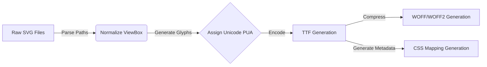

# How to Convert SVG Icons to a Custom Web Font (TTF/WOFF) in 2026

Despite the heavy shift toward inline SVGs in React and Vue ecosystems over the past few years, custom web fonts (icon fonts) remain a highly performant and caching-friendly mechanism for delivering vector iconography in enterprise web applications.

If your application loads 150+ unique icons across various states, rendering them inline bloats the DOM, resulting in increased CPU parsing times and poorer Core Web Vitals (specifically Total Blocking Time). Consolidating them into a single `WOFF2` font file leverages native browser font caching and drastically reduces DOM nodes.

## The Architectural Choice: SVG vs. Icon Font

Before converting, it's critical to understand when to use which pattern:

| Metric | Inline SVG | Icon Font (WOFF2) |
|---|---|---|
| **DOM Size** | Heavy (One `<svg>` and `<path>` node per icon) | Extremely Light (One `<i>` or `<span>` node) |
| **Styling** | Complex (`fill`, `stroke` requiring CSS classes) | Simple (Inherits text `color` and `font-size`) |
| **Caching** | Usually bundled into the JS/HTML payload | Highly cacheable static asset with an immutable URL |
| **Multi-color**| Supported | **Not supported** (Monochrome only) |

If you have a set of monochrome UI icons (like a navigation bar, user avatars, or action buttons), icon fonts are computationally cheaper for the browser to render at scale.

## The Conversion Pipeline

Behind the scenes, converting an SVG to a TrueType Font (TTF) or Web Open Font Format (WOFF) requires mapping SVG path coordinates (`d="M10..."`) to Unicode Private Use Area (PUA) glyphs. The PUA usually starts at `\ue000` to prevent screen readers from reading the icons as actual letters.



## How to Convert SVGs Offline (Zero Data Exfiltration)

Many online tools that convert SVGs to fonts upload your proprietary icons to their servers. For enterprise applications with strict NDA or security constraints, sending raw UI assets to a third-party server is a security violation.

You can perform this entire pipeline locally in your browser using the [DevOmniTools SVG to Font Converter](https://www.devomnitools.com/en/tools/svg-to-font/). 

Because the tool relies heavily on WebAssembly (Wasm) and local JavaScript Web Workers, the actual TTF/WOFF generation happens directly within your CPU's memory footprint. **Your SVGs never touch a backend server.**

### Step 1: Prepare Your SVGs
Ensure your SVGs are clean. The path must be merged into a single compound path if possible, and all `<style>` or `<clipPath>` nodes should be flattened.

*Example of a clean SVG (Close Icon):*
```xml
<svg viewBox="0 0 24 24" fill="none" xmlns="http://www.w3.org/2000/svg">
  <path d="M18 6L6 18M6 6L18 18" stroke="currentColor" stroke-width="2" stroke-linecap="round"/>
</svg>
```

### Step 2: Generate the Font 
1. Open the [SVG to Font Converter](https://www.devomnitools.com/en/tools/svg-to-font/).
2. Drag and drop your directory of `.svg` files directly into the browser.
3. Set the font name (e.g., `MyAppIcons`).
4. Click **Convert**. The local Web Worker will bundle the SVGs, assign PUA unicode values, and prompt a `.zip` download containing your TTF, WOFF, and the required CSS file.

### Step 3: Implement in CSS

Extract the bundle into your project's `/public/fonts/` directory.

Include the generated `@font-face` declaration in your global stylesheet:

```css
@font-face {
  font-family: 'MyAppIcons';
  src: url('/fonts/MyAppIcons.woff2') format('woff2'),
       url('/fonts/MyAppIcons.ttf') format('truetype');
  font-weight: normal;
  font-style: normal;
  font-display: block;
}

.icon {
  font-family: 'MyAppIcons' !important;
  speak: never;
  font-style: normal;
  font-weight: normal;
  font-variant: normal;
  text-transform: none;
  line-height: 1;
  -webkit-font-smoothing: antialiased;
  -moz-osx-font-smoothing: grayscale;
}

/* Unicode Mapping generated by the tool */
.icon-close:before {
  content: "\e001";
}
```

Now, consuming the icon in your React, Vue, or raw HTML application is as simple as:

```html
<button class="btn">
  <i class="icon icon-close" aria-hidden="true"></i> Close
</button>
```

## Summary
Building web fonts locally eliminates third-party dependency risks and keeps your deployment pipeline lean. By shifting from hundreds of inline SVGs to a single aggressively cached WOFF2 file, you significantly decrease your DOM depth and improve the rendering performance of your UI.

*Written by the DevOmniTools Team. Tested and verified on modern Chromium and Gecko engines (October 2026).*
